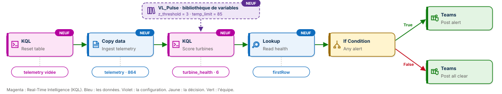

# 🌬️ Fabric Pipeline Express 6 : ingérer, analyser en KQL, décider


Un pipeline Microsoft Fabric Data Factory qui confie son calcul à un Eventhouse. La télémétrie de six éoliennes entre dans une base KQL, une seule commande KQL juge chaque machine et détecte les vibrations anormales, le pipeline lit le verdict et prévient l'équipe dans Microsoft Teams. Et aucun seuil n'est écrit dans le pipeline : la règle métier vit dans une bibliothèque de variables, on la change sans ouvrir le pipeline.

**Guide PDF de 7 pages inclus** : [`Pipeline_Fabric_Guide_6_public.pdf`](Pipeline_Fabric_Guide_6_public.pdf). Chaque activité, chaque champ, chaque commande KQL expliquée ligne par ligne, et les chiffres à retrouver à l'unité près. Toutes les commandes sont aussi dans [`data/expressions.txt`](data/expressions.txt), prêtes à copier.



## 📸 Aperçu

Le pipeline `PL_Pulse_Express` après une exécution réussie : deux activités KQL, la copie vers l'Eventhouse, le Lookup en KQL, puis la condition qui choisit entre l'alerte et le « tout va bien » dans Teams.


La table `turbine_health` interrogée dans l'ensemble de requêtes KQL de l'Eventhouse : six éoliennes, 144 relevés chacune, deux en alerte. EOL-02 pour la température de son multiplicateur, EOL-04 pour ses vibrations.


## 🎯 Résultats clés

| Indicateur | Valeur |
|---|---|
| Activités | 7 (KQL ×2, Copy data, Lookup, If Condition, Microsoft Teams ×2) |
| Nouveautés | 4 : activité KQL, copie vers une base KQL, Lookup en KQL, bibliothèque de variables |
| Relevés ingérés dans l'Eventhouse | 864, à chaque exécution, jamais doublés |
| Éoliennes jugées | 6, en une seule commande KQL |
| Éoliennes en alerte, règle stricte | 2 : EOL-02 (88,8 °C) et EOL-04 (5 vibrations anormales) |
| Écart de vibration maximal | 5,24 écarts-types, EOL-04 |
| Production du parc sur la journée | 65,1 MWh |
| Seuils écrits dans le pipeline | 0 |

## 💼 Impact métier

Le parc éolien du Plateau lorrain compte six éoliennes qui envoient un relevé toutes les dix minutes. Une vibration qui s'emballe ou un multiplicateur qui chauffe, c'est une panne qui s'annonce, et une intervention qui coûte bien moins cher avant qu'après. Ce pipeline transforme 864 relevés en une phrase livrée là où l'équipe travaille déjà : quelles éoliennes inspecter, pourquoi, et ce que le parc a produit. Et quand le responsable veut une règle plus stricte ou plus souple, il la change lui-même dans la bibliothèque de variables, sans demander une modification du pipeline.

## 📝 Résumé

`PL_Pulse_Express` commence par une activité KQL qui crée la table `telemetry` si elle manque et la vide. Un Copy data ingère `telemetry_2026-10-12.csv` du lakehouse `LH_Pulse` dans la base KQL `EH_Pulse`, qui convertit le texte en types à l'ingestion. Une seconde activité KQL lit les deux seuils de la bibliothèque `VL_Pulse`, calcule pour chaque éolienne l'énergie, le vent moyen, la température maximale et le nombre de vibrations anormales par score z, puis écrit la table `turbine_health`. Un Lookup interroge cette table en KQL et résume le verdict en une ligne. Une condition `If` choisit entre deux messages Teams : l'alerte nominative ou le « tout va bien ».

## 🔁 Pipeline

| Activité | Type | Rôle |
|---|---|---|
| `Reset table` | KQL | `.create-merge table telemetry` puis `.clear table telemetry data` : la table existe et elle est vide |
| `Ingest telemetry` | Copy data | `LH_Pulse/Files/inbox/telemetry_2026-10-12.csv` vers la base KQL `EH_Pulse`, table `telemetry` : 864 lignes |
| `Score turbines` | KQL | `.set-or-replace turbine_health` : énergie, vent, température, vibrations anormales et statut par éolienne |
| `Read health` | Lookup | Requête KQL sur `turbine_health`, première ligne : `alerts`, `turbines`, `energy_mwh`, `names` |
| `Any alert` | If Condition | `@greater(activity('Read health').output.firstRow.alerts, 0)` |
| `Post alert` | Microsoft Teams, branche True | Les éoliennes à inspecter et la production du jour |
| `Post all clear` | Microsoft Teams, branche False | Six éoliennes en ordre de marche et la production du jour |

## 🧠 Les quatre idées du projet

**Le calcul va à la donnée.** Le pipeline ne calcule rien lui-même. Il envoie une commande à l'Eventhouse, qui juge les 864 relevés là où ils sont stockés, en une fraction de seconde. Le pipeline orchestre, le moteur analytique analyse.

**Chaque machine est comparée à elle-même.** Le score z mesure de combien d'écarts-types chaque vibration s'éloigne de la moyenne de sa propre éolienne. Une machine naturellement plus vibrante n'est pas pénalisée ; seul un pic inhabituel pour elle déclenche l'alerte.

**Zéro seuil codé en dur.** Le seuil de vibration (`z_threshold`) et la limite de température (`temp_limit`) vivent dans la bibliothèque de variables `VL_Pulse`. Le pipeline les lit au lancement avec `@pipeline().libraryVariables`, et les écrit dans la commande KQL avant de l'envoyer.

**Rejouable à volonté.** Vider puis ingérer, remplacer puis lire : dix exécutions donnent dix fois 864 relevés et six lignes de verdict, jamais une de plus.

## 🎛️ Le pipeline en une image

| Étape | Dans la salle de contrôle d'un parc éolien | Dans Fabric |
|---|---|---|
| 1 | On efface le tableau de la veille | `Reset table` vide la table |
| 2 | On recopie les mesures des capteurs | Copy data ingère les 864 relevés |
| 3 | L'expert examine chaque machine selon le règlement affiché au mur | KQL juge, avec les seuils de `VL_Pulse` |
| 4 | Le chef d'équipe lit le verdict | Lookup puis If Condition |
| 5 | L'équipe d'intervention est prévenue | Microsoft Teams |

## 🧬 Traçabilité

```
VL_Pulse (bibliothèque de variables)          z_threshold = 3 · temp_limit = 85
   │  lus au lancement : @pipeline().libraryVariables
   ▼
LH_Pulse / Files / inbox / telemetry_2026-10-12.csv     864 relevés, tout en texte
   │  KQL Reset table          .create-merge table telemetry · .clear table telemetry data
   │  Copy data Ingest telemetry
   ▼
EH_Pulse / telemetry                                    864 relevés typés (datetime, long, real)
   │  KQL Score turbines        .set-or-replace turbine_health <| … score z, température, statut
   ▼
EH_Pulse / turbine_health                               6 éoliennes, 2 en ALERTE
   │  Lookup Read health        {"alerts": 2, "turbines": 6, "energy_mwh": 65.1, "names": "EOL-02, EOL-04"}
   ▼
If Condition Any alert
   ├──True──▶  Microsoft Teams Post alert       « 2 éolienne(s) à inspecter : EOL-02, EOL-04 »
   └──False─▶  Microsoft Teams Post all clear   « 6 éoliennes en ordre de marche »
```

## 🏗️ Architecture

| Objet Fabric | Type | Rôle |
|---|---|---|
| `LH_Pulse` | Lakehouse | Reçoit le fichier de télémétrie dans `Files/inbox` |
| `EH_Pulse` | Eventhouse et base KQL | Stocke `telemetry` et `turbine_health`, exécute les commandes KQL |
| `VL_Pulse` | Bibliothèque de variables | `z_threshold` et `temp_limit`, de type Nombre |
| `PL_Pulse_Express` | Pipeline | Enchaîne les sept activités et déclare les deux variables de bibliothèque |

La commande qui juge les éoliennes :

```kql
.set-or-replace turbine_health <|
let z = todouble('@{pipeline().libraryVariables.z_threshold}');
let tl = todouble('@{pipeline().libraryVariables.temp_limit}');
let s = telemetry | summarize mu = avg(vibration_mms), sd = stdev(vibration_mms) by turbine;
telemetry
| join kind=inner s on turbine
| summarize readings = count(), energy_mwh = round(sum(power_kw) / 6000.0, 2), avg_wind = round(avg(wind_ms), 1), max_temp = max(gearbox_temp_c), vib_anomalies = countif(abs(vibration_mms - mu) / sd > z) by turbine
| extend status = iff(vib_anomalies >= 3 or max_temp > tl, "ALERTE", "OK")
```

Lignes 2 et 3 : le pipeline remplace `@{…}` par les valeurs de la bibliothèque avant l'envoi. Lignes 4 à 6 : moyenne et écart-type de la vibration par éolienne, rattachés à chaque relevé. Lignes 7 et 8 : une ligne par éolienne, statut `ALERTE` dès trois vibrations anormales ou une température au-delà de la limite.

## ▶️ Les deux exécutions

| # | Réglages dans `VL_Pulse` | Branche | Message reçu dans Teams |
|---|---|---|---|
| 1 | `z_threshold` = 3 · `temp_limit` = 85 | True | Alerte parc éolien : 2 éolienne(s) à inspecter : EOL-02, EOL-04. Production du jour : 65.1 MWh. |
| 2 | `z_threshold` = 6 · `temp_limit` = 95 | False | Parc éolien : 6 éoliennes en ordre de marche. Production du jour : 65.1 MWh. |

Entre les deux exécutions, le pipeline n'a pas été ouvert. Seule la bibliothèque a changé, et la décision a suivi : la règle métier appartient au métier, le pipeline appartient à l'ingénieur.

## 📊 Résultat final

```kql
turbine_health | order by turbine asc
```

| turbine | readings | energy_mwh | avg_wind | max_temp | vib_anomalies | status |
|---|---|---|---|---|---|---|
| EOL-01 | 144 | 8,89 | 7,1 | 65,9 | 0 | OK |
| **EOL-02** | 144 | 9,74 | 7,3 | **88,8** | 0 | **ALERTE** |
| EOL-03 | 144 | 9,79 | 7,4 | 66,9 | 0 | OK |
| **EOL-04** | 144 | 11,41 | 7,6 | 67,5 | **5** | **ALERTE** |
| EOL-05 | 144 | 12,57 | 7,8 | 69,2 | 0 | OK |
| EOL-06 | 144 | 12,66 | 7,8 | 69,3 | 0 | OK |

## 📦 Jeu de données

```
data/
├── telemetry_2026-10-12.csv   864 relevés, le 12 octobre 2026 de 00:00 à 23:50
└── expressions.txt            toutes les commandes KQL et expressions du guide, prêtes à copier
```

Un relevé toutes les dix minutes pour `EOL-01` à `EOL-06`. Sept colonnes : `ts`, `turbine`, `wind_ms`, `power_kw`, `rotor_rpm`, `gearbox_temp_c`, `vibration_mms`. Deux incidents sont cachés dans la journée : cinq pics de vibration sur EOL-04, entre 6 h 40 et 7 h puis vers 16 h 10, et un multiplicateur qui chauffe jusqu'à 88,8 °C sur EOL-02 en début d'après-midi. Données fictives, conçues pour l'exercice.

## 🚀 Reproduire l'exercice

1. Créer un Eventhouse `EH_Pulse` : sa base KQL du même nom est créée avec lui.
2. Créer un lakehouse `LH_Pulse`, un dossier `Files/inbox`, et y déposer `telemetry_2026-10-12.csv`.
3. Créer une bibliothèque de variables `VL_Pulse` avec `z_threshold` = 3 et `temp_limit` = 85, de type Nombre.
4. Créer le pipeline `PL_Pulse_Express`, déclarer les deux variables dans l'onglet **Variables de bibliothèque**, puis construire les sept activités en suivant le guide et en copiant les commandes depuis `data/expressions.txt`.
5. Exécuter, lire l'alerte dans Teams, passer les réglages à 6 et 95, exécuter à nouveau sans ouvrir le pipeline.

## 📂 Structure du dépôt

```
fabric-pipeline-express-6/
├── README.md
├── Pipeline_Fabric_Guide_6_public.pdf   le guide de 7 pages
├── data/                               la télémétrie et les commandes KQL
└── images/
    ├── pipeline_diagram.svg            le schéma du pipeline
    ├── pipeline_run.png                PL_Pulse_Express après une exécution réussie
    └── kql_results.png                 la table turbine_health dans l'Eventhouse
```

## 🧰 Stack technique

Microsoft Fabric Data Factory · Real-Time Intelligence · Eventhouse et KQL · Lakehouse · Bibliothèque de variables · Microsoft Teams

## ✅ Conclusion

Un pipeline n'a pas à tout savoir. Il doit savoir à qui confier le calcul, où lire la règle, et à qui annoncer le résultat. Ici, l'Eventhouse juge, la bibliothèque de variables décide des seuils, et Teams prévient l'équipe : sept activités, et une règle métier que l'on règle sans toucher à une ligne du pipeline.

## 💭 Dernier mot

Une alerte utile ne dit pas seulement qu'il y a un problème. Elle dit lequel, où, et elle arrive avant la panne.

---

Abdoul Hamid Diallo · Microsoft Data & AI Engineer · Microsoft Certified DP-600, DP-700, PL-300, AI-102, DP-100, AI-900, DP-900 · [LinkedIn](https://www.linkedin.com/in/abdoul-hamid-diallo-fabric-data-engineer/)
